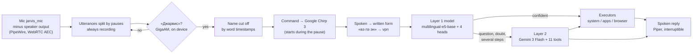

# Jarvis — a voice assistant for Ubuntu

**English** · [Русский](README.ru.md)

Jarvis lets you control your computer by voice. It opens apps, files and websites, adjusts volume and brightness,
manages windows, Wi‑Fi, Bluetooth, files and the clipboard, sets timers, answers questions and carries out multi-step
requests. It runs in the background on Ubuntu 24.04 (GNOME 46, Wayland), wakes up when you say «Джарвис» ("Jarvis")
or press **Alt+\`**, and talks back. It listens and replies in Russian, including English names spoken inside Russian speech.

The core idea is **two layers of understanding**:

- **Layer 1.** Everyday commands are parsed by our own model, right on the machine: tens of milliseconds, no network.
- **Layer 2.** Questions, vague requests and multi-step tasks go to a large model (Gemini), which acts through the
  same executors as layer 1.

There are no `if phrase == …` rules in the code. The model decides *what* to do. The code finds the target among what
is actually installed and stored on this computer.

```text
«Джарвис, открой стим»          open Steam            → Steam is up ~1.2 s after you stop talking; reply: «Выполняю» (On it)
«Джарвис, найди файл каплец»    find the file …       → ~/caplets opens in Files ("каплец" sounds like caplets)
«Джарвис, сделай громче на 20 процентов»              → volume +20%
«Джарвис, загугли how to center a div»                → English words come out in Latin script
«Джарвис, скопируй все pdf из загрузок в документы и заархивируй»   → layer 2: copy every PDF, then zip them
«Джарвис, как работает хэш-таблица?»                  → «Думаю…» (Thinking…), then a spoken answer
«Джарвис, хватит»               stop                  → interrupts the answer
```

---

## Contents

- [Features](#features)
- [How it works](#how-it-works)
- [Tech stack](#tech-stack)
- [Models](#models)
- [Quality and speed](#quality-and-speed)
- [Security and privacy](#security-and-privacy)
- [Installation](#installation)
- [Usage](#usage)
- [Configuration](#configuration)
- [Project layout](#project-layout)
- [Tests](#tests)
- [Training the models](#training-the-models)
- [Design decisions](#design-decisions)
- [Limitations](#limitations)

---

## Features

### Voice

- **Always on.** Jarvis runs as a systemd user service. You can be in a Discord call or a game and just say
  «Джарвис, открой стим». The microphone is shared with other apps through PipeWire, and conversations that don't
  start with «Джарвис» are ignored.
- **Two ways to call it.** Say «Джарвис» or press **Alt+\`** (the key above Tab, works in any layout). Press it again to
  say "I'm done talking".
- **Doesn't hear its own speakers.** The microphone goes through WebRTC echo cancellation, the same processing
  browsers and phones use, so music and its own voice are filtered out.
- **English names in Russian speech:** «открой Passwords», «включи Arctic Monkeys».
- **Short replies.** Completed actions get a brief acknowledgement (*On it*, *Doing it*, *Done*) instead of a recap.
  Information requests and layer 2 answers are read out in full. Before handing off to layer 2, Jarvis immediately
  says *Thinking…*.
- **Interruptible.** Say «Джарвис, хватит» ("Jarvis, stop") or simply give a new command.
- **Dangerous actions need a "yes".** Deleting, moving, shutting down and the like run only after a spoken
  confirmation.

### Layer 1

146 system actions, plus apps, folders, files, websites and a translator — however you phrase the request.

| Area | Actions |
|---|---|
| Files | create a folder/file, copy (to a folder or the clipboard), cut, paste, move, rename, move to Trash, empty Trash/Downloads, zip, unzip, properties, "where is it", `chmod +x` |
| Windows | close/minimize/maximize, minimize all, close all, close apps by name ("close Discord, Telegram and Steam"), switch window, overview, snap left/right, always on top, workspaces |
| Display | brightness, Night Light, dark/light theme, scaling, resolution, screen off, "keep the screen on" |
| Sound & media | volume, microphone, output to headphones/speakers/HDMI, pause, next/previous track, seek, subtitles, playback speed |
| Network | Wi‑Fi, Bluetooth (on/off, connect a device by name), airplane mode, hotspot, VPN, restart Wi‑Fi, IP address |
| System | notifications, screenshots, screen recording, lock, shutdown/reboot/suspend (optionally on a timer), keyboard layout, updates, disk, memory, CPU, battery, OS version, time |
| Everyday | timer, reminder with a message, alarm ("at half past six"), wallpaper, install/remove apps via App Center |
| Browser & keys | tabs, scrolling, page zoom, back/forward, incognito, clipboard, undo/redo, Enter/Esc/F‑keys |
| Apps & sites | any installed app (`.desktop`, `PATH`), Steam games, standard and personal folders and files, websites with on-site search, YouTube (straight to the first video or a channel), Google, Google Translate (29 languages) |

### Layer 2 (Gemini)

Questions and anything that isn't a single action land here:

- "copy every PDF from Downloads to Documents and zip them";
- "what's eating my CPU right now";
- "write a shopping list into notes.txt".

Layer 2 has 11 tools:

- every layer 1 executor;
- read-only tools: list a folder, find files, run safe Linux commands, read text files;
- any shell command (only after a "yes");
- write text to a file;
- list installed apps.

---

## How it works



### 1. Audio

`--install` creates a virtual PipeWire microphone, `jarvis_mic`. It is the `echo-cancel` module running WebRTC: it
subtracts everything the laptop's speakers are playing and suppresses steady background noise.

Jarvis reads that microphone through `pacat` on a dedicated thread, in 30 ms frames, into a 30-second queue. Nothing
you say is lost while it is executing a command or talking.

### 2. Utterances and the wake word

**Utterance boundaries** are detected by loudness, adapting to the room's noise floor. An utterance ends after 1.2 s
of silence.

**The wake word** is spotted by GigaAM v3 **on the device**, so background audio never leaves the computer:
- It is searched for in the first 3 s of every stretch of speech inside an utterance, not only at its start. A new
  stretch begins after a pause of 0.25 s or more; mouse clicks and keystrokes don't count.
- So "well, okay… Jarvis, open Steam", said in one breath, still counts as addressing Jarvis.

**Matching the name** is done by a trained sound-alike model:
- how GigaAM actually spells *your* voice — «Джарвис», «Джарус», «Дарвис», «Джарес» — is accepted; «джава» is not;
- borderline cases (similarity 0.8–0.9) are double-checked with the cloud recognizer.

### 3. The command

GigaAM only knows Russian and writes English by ear in Cyrillic («паспортс», «халтусентер эдиф»). That is why the
command itself is transcribed by **Google Chirp 3**. The name is cut off using GigaAM's word timestamps, so the cloud
only ever receives the command.

Jarvis doesn't always wait for the full pause:
- **0.45 s of silence.** It already checks for the wake word and sends the command audio to the cloud.
- **0.8 s of silence.** A clear, complete command ("open Steam", "louder") is treated as finished. The bar is high:
  - the model is confident;
  - it isn't a question or a dangerous action;
  - the command has a real target;
  - the phrase doesn't end on a preposition.
- **1.2 s of silence.** Everything else ("open the folder…", "set the volume to…") waits for the full pause.
- **You start talking again** — the early guess is thrown away.
- **No network** (or no cloud answer within 3 s) — GigaAM's transcript is used instead.

### 4. Understanding

`jarvis/spoken.py` turns spoken forms into written ones: «вэ пэ эн» → `vpn`, «мейн точка пай» → `мейн.py`,
«нижнее подчёркивание» → `_`.

In a single forward pass, the layer 1 model produces:
- a route: `browser | app | system | translate | llm`;
- a canonical action (154 classes);
- a target language for translation;
- word tags: which words are the site, the query, the text.

The decision is made by a pure function, `ml_spec.decide`, which applies confidence thresholds and structural sanity
checks. When the model is unsure, the phrase goes to layer 2 instead of being executed blindly.

### 5. Execution

Targets are looked up among what really exists on the machine, in this order:

1. standard folders;
2. Settings panels, by their system names;
3. installed apps (`.desktop` files and `PATH`);
4. Steam games («дота два» → Dota 2);
5. the user's files and folders;
6. semantic search (MiniLM): «пароли» (passwords) → Passwords and Keys, «видеоплеер» (video player) → Videos.

Names are compared by sound using the name model: «каплец» = `caplets`, «дом лутс» = Downloads. When nothing matches
confidently («блокнот» — notepad, «проводник» — explorer: that's world knowledge, not word meaning), the phrase goes to
layer 2, which looks at the list of installed apps and opens the right one.

Apps and the browser launch without blocking. Jarvis watches the process for 2.5 s in the background and tells you
if the launch failed.

### 6. Layer 2

Gemini 3 Flash on Vertex AI, via the OpenAI-compatible API with function calling.
- **Reasoning.** The first response is fast (`reasoning_effort=minimal`), which is enough for a question. Once the model
  starts using tools, it reasons at its default level.
- **Memory.** It remembers the conversation for 15 minutes: "now zip them".

The large model teaches the small one. Any phrase Gemini handled with a single action is written to `ml/teacher.jsonl`,
ready to be used as a training example for layer 1 in your own wording.

### 7. Reply

- Completed actions are not recapped: *On it*, *Doing it*, *Done* — never the same one twice in a row.
- Information (time, battery, memory, IP), layer 2 answers and failure reasons are read out in full.
- The voice is Piper (VITS in ONNX + libespeak-ng phonemes), fully offline, ~0.2 s per sentence.
- Jarvis keeps listening while it talks: «Джарвис…» cuts the reply off within ~0.5 s.

---

## Tech stack

| Area | Technology | Why |
|---|---|---|
| Language & runtime | Python 3.12, systemd user service | one command, `assistant.py --install`; apps Jarvis opened survive its restarts |
| Audio | PipeWire 1.0: `pacat`, `module-echo-cancel` (WebRTC AEC + noise suppression), monitor mode | a microphone that doesn't hear the laptop's own speakers |
| Wake word & offline ASR | **GigaAM v3** e2e RNN-T (Sber), int8, via `onnx-asr` + `onnxruntime` | Russian speech on device in ~0.1 s, with word timestamps |
| Command ASR | **Google Cloud Speech-to-Text v2, Chirp 3** (eu region, REST via `httpx`) | mixed Russian/English speech: 42 of 45 English names vs 29 for GigaAM |
| Command understanding | **multilingual-e5-base** (XLM-RoBERTa, 12 layers, ~278M parameters), fine-tuned with 4 heads; PyTorch (CPU), Transformers | route, action, language and word tags in one pass, ~0.05 s |
| Sound-alike names | custom model: character-level bidirectional GRU bi-encoder in PyTorch, 2 MB | «каплец» = caplets — for files, apps, games and the wake word |
| Semantic search | `paraphrase-multilingual-MiniLM-L12-v2` (Transformers) | «пароли» (passwords) → Passwords and Keys |
| Large model | **Gemini 3 Flash** on Vertex AI: OpenAI-compatible endpoint, `openai` SDK + `google-auth` token, function calling | questions and multi-step tasks through the same executors |
| Text-to-speech | **Piper** (VITS, ONNX) + `libespeak-ng` via `ctypes`; optionally Google Cloud TTS (Chirp 3 HD) | offline voice, ~0.2 s per sentence |
| GNOME integration | D-Bus (Nautilus `FileOperations2`, `FileManager1`, Mutter RemoteDesktop, MPRIS), `gsettings`, `gnome-control-center` | file operations with undo and Trash, key presses on Wayland, media control, Settings, a custom hotkey |
| System | `wpctl`/`pactl`, `nmcli`, `bluetoothctl`, `powerprofilesctl`, `systemctl`, Firefox / `xdg-open`, Steam URIs | sound, network, Bluetooth, power, browser, games |
| Tests | `pytest`: 239 tests, ~7.5k subtests; live model exams | no network, no microphone, no speakers |
| Training data | phrase generator built from sentence patterns; Piper → GigaAM (synthetic speech); Gemini (Russian-ear spellings) | training without hand-labelling thousands of phrases |

Tested with:
- Python 3.12.3;
- torch 2.14 (CPU), transformers 5.21;
- onnx-asr 0.12, onnxruntime 1.32;
- openai 2.54, httpx 0.28, google-auth 2.62;
- pytest 9.1.

---

## Models

| Model | Location | Size | What it does | Quality |
|---|---|---|---|---|
| Layer 1 (release r8) | `ml/ml_model` | 1.1 GB | phrase → route, action (154 classes), language (29 + "none"), word tags | 97.4% on your own phrases, 99.3% on the exam ([details](#quality-and-speed)) |
| Sound-alike names | `ml/name_model` | 2 MB | embeds how a name sounds; similarity 0…1, threshold 0.82 calibrated on a held-out set | 97% vs 75% for the previous hand-written algorithm |
| GigaAM v3 e2e int8 | Hugging Face cache | 225 MB | Russian speech → text and word timestamps | — |
| Piper `ru_RU-irina-medium` | Hugging Face cache | 63 MB | text → speech | — |
| MiniLM-L12 multilingual | Hugging Face cache | 470 MB | finds apps and Settings panels by meaning | — |
| Gemini 3 Flash, Chirp 3 | Google Cloud | — | layer 2; command transcription | 143–145 of 154 on the layer 2 exam |

Hugging Face models are downloaded on first run. After that, everything except Chirp and Gemini works offline.

Memory footprint is about 2 GB:
- parser ~0.8 GB;
- GigaAM ~0.5 GB;
- torch ~0.25 GB;
- semantic search ~0.15 GB.

---

## Quality and speed

### Layer 1

Exam results (`traning ml/exam_r8.txt`):

| Set | Phrases | Correct right away | Handed to layer 2 (safe) | Silent errors |
|---|---|---|---|---|
| Hard cases from real use | 109 | 100% | 0% | 0% |
| Exam | 305 | 99.3% | 0.3% | 0.3% |
| Your own phrases (never used in training) | 721 | 97.4% | 0.8% | 1.8% |
| Held-out phrases with unseen sites, apps and artists | 1200 | 94.4% | 0.6% | 5.0% |

The offline path (noise → voice activity detection → GigaAM → written form → parser) was tested on 60 corpus phrases
read by natural-sounding voices: 58 of 60 led to the same action as the typed phrase.

### English names in Russian speech

45 synthesized recordings: 15 commands, each read by three voices — Google Charon, Google Kore and Piper irina. The
Piper voice has a strong Russian accent.

| Recognizer | Total | Accented voice | Time per phrase |
|---|---|---|---|
| GigaAM v3 | 29/45 | 6/15 | ~0.1 s |
| Gemini 3 Flash on audio | 44/45 | 14/15 | 2.6 s median, up to 25 s |
| **Chirp 3** | **42/45** | **14/15** | **~0.7 s** |

### Sound-alike names

On names never seen in training, the name model was compared with the previous hand-written algorithm
(transliteration + "consonant skeleton"):

| Set | Model | Hand-written |
|---|---|---|
| Russian-ear spellings (at the same false-match rate) | 97% | 75% |
| Real GigaAM misspellings | 12 of 13 | 9 of 13 |

### Layer 2

A live exam of 154 phrases, with actions stubbed out: 143–145 correct in every reasoning mode.
- Fast first response: 3.1 s on average.
- When the model chose its own reasoning depth: 4.9 s.

### Latency

Measured in real time: Piper voice in, real GigaAM, Chirp and parser.

| Command | End of speech → command ready |
|---|---|
| «Джарвис, открой стим» (open Steam) | 1.23 s |
| «Джарвис, сделай громче» (louder) | 1.38 s |
| «Джарвис, открой папку» (open the folder — waits for the full pause) | 1.39 s |
| «Джарвис, найди на ютубе рецепт борща» (find a borscht recipe on YouTube) | 1.52 s |

The app, folder or site opens right after that. The bottleneck is now the cloud round trip (~0.7 s).

At idle:
- Jarvis uses about 1% of one CPU core;
- echo cancellation in PipeWire uses ~3% of a core.

---

## Security and privacy

**What goes to the cloud:**
- the command audio after «Джарвис» — to Chirp, without the name itself;
- questions and unclear requests — to Gemini;
- the reply text — only if a Google voice is selected.

Background audio, the wake word and "yes/no" answers never leave the computer. Audio is never stored.

**Confirmation.** Models can be confidently wrong (once, «выруби звук» — "kill the sound" — was read as "shut down
the computer"), so it is the consequences that are guarded. Dangerous actions in both layers — delete, move, rename,
shut down, log out and similar — run only after a "yes", and the question says exactly what will happen.

**Files.**
- File actions never leave the home folder and removable drives.
- Hidden and sensitive files are off-limits.
- Moving never overwrites existing files.
- "Close X" never kills system processes or the assistant itself.

**Layer 2 shell access.**
- Read-only commands come from an allowlist with argument checks: `uptime`, `du`, `nmcli device wifi list`,
  `systemctl status` and similar. No pipes, no `sudo`.
- Process command lines, Wi‑Fi passwords and environment variables are never shown.
- Any other command runs only after a "yes", and its exact text is shown in a notification.
- `sudo` and long-running commands open in a terminal window, where you type the password yourself.
- Never allowed: wiping a disk, deleting `/` or the whole home folder, `curl | sh`, commands containing keys or
  passwords.

**Secrets.**
- Layer 2 never sees keys, `~/.ssh`, `~/.config/pc_agent`, browser profiles or keyrings.
- The Google credential is a single service-account JSON file with `600` permissions.
- No keys live in the code or the repository.

**Tests** never open the real microphone, never play sound and never send audio to the cloud. Any test that tries
fails immediately; `tests/conftest.py` enforces this.

---

## Installation

**Requirements:**
- Ubuntu 24.04 with GNOME 46 (Wayland), Python 3.12, PipeWire, Firefox;
- a Google Cloud project with:
  - **Vertex AI API** and **Cloud Speech-to-Text API** enabled;
  - a service account with the **Vertex AI User** and **Cloud Speech Client** roles.

```bash
git clone https://github.com/serezakot/PC-agent-on-Linux.git ~/Desktop/pc_agent_project
cd ~/Desktop/pc_agent_project
python3 -m venv .venv
.venv/bin/pip install torch --index-url https://download.pytorch.org/whl/cpu   # CPU-only torch, no CUDA
.venv/bin/pip install -r requirements.txt

mkdir -p ~/.config/pc_agent && chmod 700 ~/.config/pc_agent
cp <service-account-key>.json ~/.config/pc_agent/vertex-sa.json
chmod 600 ~/.config/pc_agent/vertex-sa.json

.venv/bin/python assistant.py --install
```

`--install` sets everything up in one go:
- the `jarvis` systemd user service, started at login;
- the echo-free `jarvis_mic` microphone, as a PipeWire drop-in at
  `~/.config/pipewire/pipewire.conf.d/60-jarvis-echo-cancel.conf` (your default microphone is left unchanged);
- the **Alt+\`** hotkey, a GNOME custom shortcut that signals the service to start listening.

`--uninstall` reverts all of it.

The layer 1 weights (`ml/ml_model`, 1.1 GB) are not in git. Produce them with the training lab (see
[Training the models](#training-the-models)) or copy a trained model into `ml/ml_model/`. The name model
(`ml/name_model`, 2 MB) ships with the repository.

**Cloud cost.** Chirp costs about $0.016 per minute of command audio. Gemini, Chirp and the Google voices are billed
to the same Google Cloud project.

---

## Usage

**By voice.** Say «Джарвис», wait for the beep and give the command — or say it all at once: «Джарвис, открой стим».
- You can pause for up to 1.2 s mid-command.
- Called twice, or again after the beep? Jarvis beeps again and waits for the command.

**By hotkey.** Press **Alt+\`**, wait for the beep and give the command without the wake word.
- You can pause for up to 2 s.
- Press it again when you're done talking.
- Pressing it while Jarvis is talking cuts the reply off.

**Interrupting** while Jarvis is talking:
- «Джарвис, хватит» ("Jarvis, stop") — it goes quiet;
- «Джарвис, открой стим» — it goes quiet and does the new command.

**Command line:**

```bash
.venv/bin/python assistant.py                   # Jarvis in the terminal: voice, plus typing (exit to quit)
.venv/bin/python assistant.py "открой стим"     # run a single typed command
.venv/bin/python assistant.py --uninstall       # remove the service, hotkey and echo-free mic
journalctl --user -u jarvis -f                  # what it hears and does
systemctl --user restart jarvis                 # restart the service
```

After every command the log shows who handled it and how long it took (the assistant's own output is in Russian):

```text
🎤 «Джарвис, который час?» -> «который час»  (распознано за 0.71 с)
⏱ ответил ПЕРВЫЙ СЛОЙ — парсер: system/sys_time, уверенность 0.99. Разбор 0.24 с + выполнение 0.00 с = 0.24 с
🔊 Сейчас 20:33, вторник, 17 ноября 2026
```

When the wake word was heard but not accepted, the log shows «👂 похоже на обращение, но не принято: «…»»
("sounded like a call, but not accepted"), so you can see how the recognizer spelled the name.

---

## Configuration

| Setting | Where | Default |
|---|---|---|
| Google Cloud key (Gemini, Chirp, Google voices) | `~/.config/pc_agent/vertex-sa.json` | — |
| Voice | `~/.config/pc_agent/voice` or the `PC_AGENT_VOICE` variable. Offline: `piper:irina`, `piper:dmitri`, `piper:denis`, `piper:ruslan`; cloud: `google:Chirp3-HD-Kore` and other Chirp 3 HD voices | `piper:irina` |
| Log of your phrases (for fine-tuning) | `ml/parse_log.jsonl`; disable with `ML_PARSE_LOG=0` | on |
| Layer 2 examples for training layer 1 | `ml/teacher.jsonl` | on |

About voices:
- A new Piper voice is downloaded the first time you select it.
- Google voices sound more natural but take ~1 s, and the reply text is sent to Google. Without a network, Piper
  speaks instead.

Phrase logs are personal and kept out of the repository (`.gitignore`). `python3 ml/ml_log.py` lists the doubtful
phrases from the log.

---

## Project layout

```text
assistant.py              the single entry point (CLI, service)
jarvis/
├── app.py                Jarvis main loop, CLI commands, installing the service / hotkey / echo-free mic
├── listen.py             always-on mic, utterances by pauses, wake word, Chirp, guesses during the pause, barge-in, yes/no
├── speak.py              voice (Piper / Google), short replies, stopping mid-sentence
├── spoken.py             spoken → written form: numbers, spelled-out abbreviations, file extensions, symbols
├── parser.py             layer 1 model (model code lives in ml/)
├── dispatcher.py         phrase → executor or layer 2; confirming dangerous actions; is the command complete; timing report
├── apps.py               apps, Steam games, folders and files, Settings panels; non-blocking launches
├── names.py              the sound-alike name model
├── semantic.py           finding apps and Settings panels by meaning
├── browser.py            websites, on-site search, YouTube, Google, Translate
├── system/               146 system actions by domain: files, audio, display, network, power, windows, keyboard, …
├── llm.py                layer 2: Gemini, tools, conversation history, reasoning mode
├── shell.py              any command (after a "yes"), writing text to a file, listing apps
└── sys_query.py          safe read-only Linux commands and file reading for layer 2
ml/                       layer 1 model (code shared with the "traning ml" lab)
├── ml_spec.py            routes, action classes, languages, thresholds, decide()
├── ml_model.py           encoder + 4 heads
├── ml_infer.py           phrase parsing
├── ml_log.py             real-phrase log and review of doubtful phrases
├── ml_model/             layer 1 weights (not in git)
└── name_model/           name model weights (2 MB)
tests/                    tests and phrase corpora
requirements.txt
```

---

## Tests

```bash
.venv/bin/python -m pytest tests/ -q                # 239 tests, ~7.5k subtests; no network, mic or speakers
.venv/bin/python tests/run_model.py --set system    # ~630 system/app/llm phrases through the real layer 1 model
.venv/bin/python tests/run_model.py --set browser   # ~1200 browser / translate / llm phrases
.venv/bin/python tests/run_voice_text.py            # the corpus in "as transcribed" form: same action as the typed phrase?
.venv/bin/python tests/run_llm.py --fails           # live layer 2 exam (154 phrases, actions stubbed out)
```

| File | What it covers |
|---|---|
| `cases_system.py`, `cases_system_big.py`, `cases.py` | hand-written corpus: ≥3 phrasings for each of the 146 actions, apps, layer 2 phrases, ~1200 browser phrases |
| `test_system.py`, `test_system_fs.py` | "perfect parser" → executor for the whole corpus; real file operations in a temp folder; non-blocking launches |
| `test_deep.py` | argument parsing, no false name matches, "close X" never touches the system, files never leave home, 146 actions × 21 kinds of junk input |
| `test_spoken.py` | spoken language: numbers, abbreviations, times in words, sound-alike names, the command allowlist, hidden files, a clipboard race |
| `test_voice.py` | voice activity detection, wake word mid-utterance, hotkey, yes/no, Chirp and offline fallback, cutting off the name, guesses during the pause and early end, barge-in, replies, synthesis, installation |
| `test_llm.py`, `test_executor.py` | layer 2 without a network: confirmations, provider errors, history, reasoning mode; browser and translator |
| `test_shell.py` | layer 2 commands: what runs right away, after a "yes", or never; writing files; unknown apps go to Gemini; training examples |

---

## Training the models

Training lives in a separate folder, `~/Desktop/traning ml/`, with its own `README.md`. The assistant's code is not
copied there: the scripts import it through `_project.py` and use the project's `.venv`.

### Layer 1

**Data.** Nothing is labelled by hand. A generator builds phrases from sentence patterns (`ml_gen.py`, ~81k phrases).
Sources:
- action templates;
- lists of websites and apps;
- English names as a Russian speaker hears them;
- your own phrases from `ml_real.tsv`, with variations.

**Training.** A new release is fine-tuned from r8:
- the bottom 6 of 12 layers are frozen;
- 2 epochs;
- about an hour on a Ryzen 7 7840HS, no GPU.

**Promotion.** The new model is written to `ml/ml_model_new`. It replaces the working model only if it is no worse
on every exam:
- the exam, `ml_exam.py`;
- your phrases, `ml_mine.tsv`;
- the held-out probe, `ml_probe.py`;
- the name probe, `names_probe.py`;
- the project corpus, `tests/run_model.py`.

```bash
cd ~/Desktop/traning\ ml
python3 ml_gen.py --out data --mode final --n 48000 --real-aug 8
python3 ml_train.py --mode final --resume ~/Desktop/pc_agent_project/ml/ml_model --freeze-layers 6 --epochs 2
python3 ~/Desktop/pc_agent_project/tests/run_model.py --model ~/Desktop/pc_agent_project/ml/ml_model_new
```

### Name model

**Data** — ~26k pairs of "how GigaAM wrote it" → "how it's actually spelled", covering 2.9k names:
- Piper reads each name: 4 Russian voices, varied speed, room noise.
- GigaAM transcribes what it hears.
- Gemini adds Russian-ear spellings — for public names only; your own file names never leave the computer.

**Training.** Contrastive learning with hard negatives, about 30 minutes. The threshold is calibrated so that a
similarity of 0.82 produces no more false matches than the old hand-written comparison.

### Adding an action

1. Add the action name to `SYSTEM_ACTIONS` in `ml/ml_spec.py` (at the end of the list).
2. Add phrases built from sentence patterns to a `tpl_system_*` template in `traning ml/ml_gen.py`. These are
   training data, not parsing rules.
3. Add a handler with `@_register("name")` in `jarvis/system/<domain>.py`.
4. Regenerate the data and fine-tune.

Real phrases are logged to `ml/parse_log.jsonl`, and `python3 ml/ml_log.py` lists the doubtful ones. Those go into
`traning ml/ml_real.tsv` (training) or `ml_mine.tsv` (exam only, never used for training).

---

## Design decisions

1. **Two layers instead of one big model.** Our own model handles ~97% of real commands in tens of milliseconds,
   offline. The cloud is only needed for questions and complex requests. When layer 1 is unsure, that isn't a
   failure — it's a handoff to layer 2.
2. **No phrase rules.** The model decides what to do. Executors find the target among what is installed, not in
   hand-made dictionaries.
   - The tables that remain hold language knowledge: number words, letter names, prepositions.
   - A few cover things the model measurably can't replace: YouTube's spellings across Russian cases, Bluetooth brands.
3. **Wake word on device, command in the cloud.** GigaAM is fast and private but only knows Russian; Chirp gets the
   English names right. There is no reason to stream all background audio to the cloud just to hear «Джарвис».
4. **The name is cut off before the cloud.** Chirp used to hear «Джарвис» as «Да, Алиса» ("Yes, Alice"). Thanks to
   GigaAM's word timestamps, only the command is sent.
5. **Echo cancellation, not volume tricks.** The raw microphone picks up the speakers' output and GigaAM transcribes
   it; on `jarvis_mic` the same audio is silence (−88 dB). It's the same processing that keeps ChatGPT's voice mode
   from hearing your music.
6. **A learned name matcher instead of hand-written transliteration.** 97% vs 75%. New files are recognized without
   retraining, because the model compares against what is on disk right now.
7. **Bad transcription isn't fixed by retraining the parser.** Four fine-tuning rounds on "English names as heard in
   Russian" improved names but shifted other skills: music, translation, and once «выруби звук» ("kill the sound")
   turned into a shutdown. Given a correctly spelled name, the working parser already gets it right 99.7–100% of
   the time — so the transcription was fixed instead.
8. **Don't wait for what can be checked in the background.**
   - App launches are watched in the background: −2.5 s.
   - The command is transcribed while you are still pausing.
   - Fast first response from the large model: −1.8 s on average.

---

## Limitations

- **Ubuntu 24.04 / GNOME on Wayland only.** Keys, windows and files go through GNOME and Mutter D-Bus APIs.
- **English names are recognized best online** (Chirp). Offline, GigaAM transcribes the command and the name model
  finds the names.
- **Layer 2 uses a preview model** (`gemini-3-flash-preview`). If it changes, update the model name in `jarvis/llm.py`.
- **The wake word is spotted by a general speech model,** not a dedicated keyword detector. Unusual spellings of
  the name are caught by the name model and the cloud check; misses show up in the log.
- **Echo cancellation only removes the laptop's own audio** — not a phone speaker or people talking in the room.
- **Early end-of-command helps only a little so far:** the cloud round trip (~0.7 s) is the bottleneck.
- **Single user, Russian language.**
