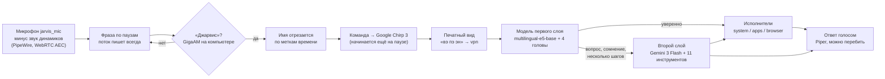

# Джарвис — голосовой ассистент для Ubuntu

[English](README.md) · **Русский**

Джарвис управляет компьютером голосом. Он открывает программы, файлы и сайты, меняет громкость и яркость, работает с окнами,
сетью, Bluetooth, файлами и буфером обмена, ставит таймеры, отвечает на вопросы и выполняет многошаговые просьбы.
Работает в фоне на Ubuntu 24.04 (GNOME 46, Wayland). Позвать его можно словом «Джарвис» или клавишей **Alt+\`**, отвечает он голосом.

Главная идея — **два слоя понимания**:

- **Первый слой.** Обычные команды разбирает своя модель прямо на компьютере: десятки миллисекунд, без сети.
- **Второй слой.** Вопросы, размытые и многошаговые просьбы уходят большой модели (Gemini). Она действует теми же исполнителями, что и первый слой.

Правил вида «если фраза = …» в коде нет. Что сделать, решает модель, а код находит цель среди того, что реально
установлено и лежит на этом компьютере.

```text
«Джарвис, открой стим»                  → Steam открыт через ~1,2 с после конца фразы; ответ: «Выполняю»
«Джарвис, найди файл каплец»            → папка ~/caplets в файловом менеджере («каплец» = caplets на слух)
«Джарвис, сделай громче на 20 процентов»
«Джарвис, загугли how to center a div»  → английские слова распознаются латиницей
«Джарвис, скопируй все pdf из загрузок в документы и заархивируй»   → второй слой, несколько шагов
«Джарвис, как работает хэш-таблица?»    → «Думаю…» и ответ голосом; перебить: «Джарвис, хватит»
```

---

## Содержание

- [Возможности](#возможности)
- [Как это работает](#как-это-работает)
- [Технологии](#технологии)
- [Модели](#модели)
- [Качество и скорость](#качество-и-скорость)
- [Безопасность и приватность](#безопасность-и-приватность)
- [Установка](#установка)
- [Использование](#использование)
- [Настройка](#настройка)
- [Структура проекта](#структура-проекта)
- [Тесты](#тесты)
- [Обучение моделей](#обучение-моделей)
- [Архитектурные решения](#архитектурные-решения)
- [Ограничения](#ограничения)

---

## Возможности

### Голос

- **Всегда в фоне.** Работает как служба systemd пользователя: можно сидеть в Discord или в игре и сказать «Джарвис, открой стим».
  Микрофон делится с другими программами через PipeWire. Чужой разговор без слова «Джарвис» пропускается.
- **Как позвать.** Словом «Джарвис» или клавишей **Alt+\`** (клавиша над Tab, в любой раскладке). Повторное нажатие
  означает «я договорил».
- **Не слышит музыку и свой голос.** Микрофон работает с подавлением эха WebRTC, как в браузере и телефоне.
- **Английские названия в русской речи:** «открой Passwords», «включи Arctic Monkeys».
- **Короткие ответы.** Сделанное не пересказывается: «Выполняю», «Делаю», «Готово». Справка и ответ большой модели
  звучат целиком; перед большой моделью Джарвис сразу говорит «Думаю».
- **Можно перебить.** «Джарвис, хватит» или новая команда.
- **Опасное — только после «да».** Удалить, переместить, выключить и подобное выполняется только после подтверждения голосом.

### Первый слой

146 системных действий плюс программы, папки, файлы, сайты и переводчик — в любой формулировке.

| Группа | Действия |
|---|---|
| Файлы | создать папку/файл, скопировать (в папку или в буфер), вырезать, вставить, переместить, переименовать, удалить в корзину, очистить корзину/загрузки, zip, распаковать, свойства, «где лежит», chmod +x |
| Окна | закрыть/свернуть/развернуть, свернуть все, закрыть все, закрыть программы по имени («закрой дискорд, телеграм и стим»), переключить окно, обзор, прилепить влево/вправо, поверх всех, рабочие столы |
| Экран | яркость, ночной свет, тёмная/светлая тема, масштаб, разрешение, выключить экран, «не выключай экран» |
| Звук и медиа | громкость, микрофон, вывод на наушники/колонки/HDMI, пауза, трек, перемотка, субтитры, скорость |
| Сеть | Wi‑Fi, Bluetooth (вкл/выкл, подключить устройство по имени), авиарежим, точка доступа, VPN, перезапуск Wi‑Fi, IP‑адрес |
| Система | уведомления, скриншоты, запись экрана, блокировка, выключение/перезагрузка/сон (с таймером), раскладка, обновления, диск, память, процессор, батарея, версия системы, время |
| Повседневное | таймер, напоминание с текстом, будильник («в половине седьмого»), обои, установка/удаление программ через Центр приложений |
| Браузер и клавиши | вкладки, прокрутка, масштаб страницы, назад/вперёд, инкогнито, буфер обмена, undo/redo, Enter/Esc/F‑клавиши |
| Программы и сайты | любая установленная программа (`.desktop`, PATH), игры Steam, стандартные и ваши папки и файлы, сайты с поиском по ним, YouTube (сразу первое видео или канал), Google, Google Переводчик (29 языков) |

### Второй слой (Gemini)

Сюда уходят вопросы и всё, что не сводится к одному действию:

- «скопируй все pdf из загрузок в документы и заархивируй»;
- «что сейчас грузит процессор»;
- «запиши в заметки.txt список покупок».

У второго слоя 11 инструментов:

- все исполнители первого слоя;
- только читающие: список папки, поиск файлов, безопасные команды Linux, чтение текстовых файлов;
- любая команда оболочки (только после «да»);
- запись текста в файл;
- список установленных программ.

---

## Как это работает



### 1. Звук

`--install` создаёт в PipeWire виртуальный микрофон `jarvis_mic`. Это модуль `echo-cancel` на WebRTC: из сигнала
вычитается всё, что играют динамики ноутбука, и глушится ровный шум.

Джарвис читает этот микрофон через `pacat` в отдельном потоке, кадрами по 30 мс, в очередь на 30 с. Поэтому сказанное
не теряется, пока он выполняет команду или говорит.

### 2. Фраза и обращение

**Границы фразы** определяются по громкости, с подстройкой под шум комнаты. Фраза кончается после 1,2 с тишины.

**Слово «Джарвис»** ищет GigaAM v3 **на компьютере**, поэтому фоновый звук никуда не уходит:
- Слово ищется в первых 3 с каждого высказывания внутри фразы, а не только в её начале. Новое высказывание начинается
  после паузы от 0,25 с. Щелчки и стук клавиш не в счёт.
- Поэтому «так, ну вот… Джарвис, открой стим», сказанное одной фразой, — тоже обращение.

**Сравнение с именем** делает обученная модель звучания:
- ваши записи «Джарвис», «Джарус», «Дарвис», «Джарес» — да; «джава» — нет;
- сомнительные случаи (сходство 0,8–0,9) переспрашиваются у облака.

### 3. Команда

GigaAM знает только русский и пишет английское на слух русскими буквами: «паспортс», «халтусентер эдиф». Поэтому
саму команду распознаёт **Google Chirp 3**. Имя отрезается по меткам времени GigaAM, и облако получает только команду.

Ждать конца паузы целиком не обязательно:
- **0,45 с тишины.** Джарвис уже проверяет обращение и отправляет запись команды в облако.
- **0,8 с тишины.** Ясная полная команда («открой стим», «сделай громче») считается законченной. Условие строгое:
  - модель уверена;
  - это не вопрос и не опасное действие;
  - у команды есть настоящая цель;
  - фраза не кончается предлогом.
- **1,2 с тишины.** Остальные команды («открой папку…», «поставь громкость на…») ждут полную паузу.
- **Вы снова заговорили** — догадка выбрасывается.
- **Нет сети** (или облако молчит дольше 3 с) — берётся запись GigaAM.

### 4. Понимание

`jarvis/spoken.py` переводит устную речь в печатный вид: «вэ пэ эн» → vpn, «мейн точка пай» → мейн.py,
«нижнее подчёркивание» → `_`.

Модель первого слоя за один проход выдаёт:
- маршрут: `browser | app | system | translate | llm`;
- каноническое действие (154 класса);
- язык перевода;
- разметку слов: где сайт, где запрос, где текст.

Решение принимает чистая функция `ml_spec.decide`: она применяет пороги уверенности и структурные проверки. Если
модель сомневается, фраза уходит второму слою, а не выполняется вслепую.

### 5. Исполнение

Цель ищется среди того, что реально есть на машине, в таком порядке:

1. стандартные папки;
2. панель настроек по её системному имени;
3. установленные программы (`.desktop` и PATH);
4. игры Steam («дота два» → Dota 2);
5. файлы и папки пользователя;
6. поиск по смыслу (MiniLM): «пароли» → Passwords and Keys, «видеоплеер» → Videos.

Названия сравниваются на слух моделью звучания: «каплец» = `caplets`, «дом лутс» = Downloads. Если уверенности нет
(«блокнот», «проводник» — это знание мира, а не смысл слов), фраза уходит второму слою: Gemini смотрит список
программ и открывает нужную.

Программы и браузер запускаются без ожидания. Не упал ли запуск, Джарвис проверяет 2,5 с в фоне и о неудаче скажет сам.

### 6. Второй слой

Gemini 3 Flash на Vertex AI через OpenAI-совместимый API с вызовом функций.
- **Размышление.** Первый ответ — быстро (`reasoning_effort=minimal`), и на вопрос этого хватает. Если модель начала
  действовать инструментами, дальше она думает как обычно.
- **Память.** Помнит разговор 15 минут: «а теперь заархивируй их».

Большая модель учит маленькую. Фраза, которую Gemini выполнил одним действием, записывается в `ml/teacher.jsonl` —
это готовый пример для дообучения первого слоя на ваших формулировках.

### 7. Ответ

- Сделанное не пересказывается: «Выполняю», «Делаю», «Есть» — без повторов подряд.
- Справка (время, батарея, память, IP), ответ второго слоя и причина неудачи звучат целиком.
- Голос — Piper (VITS в ONNX + фонемы libespeak-ng), офлайн, ~0,2 с на фразу.
- Пока Джарвис говорит, он слушает: «Джарвис…» обрывает ответ за ~0,5 с.

---

## Технологии

| Область | Технология | Зачем |
|---|---|---|
| Язык и запуск | Python 3.12, служба systemd пользователя | одна команда `assistant.py --install`; программы, открытые Джарвисом, переживают его перезапуск |
| Звук | PipeWire 1.0: `pacat`, `module-echo-cancel` (WebRTC AEC + шумоподавление), monitor mode | микрофон без звука собственных динамиков |
| Обращение и офлайн-распознавание | **GigaAM v3** e2e RNN-T (Сбер), int8, через `onnx-asr` + `onnxruntime` | русская речь на компьютере за ~0,1 с, с метками времени слов |
| Распознавание команды | **Google Cloud Speech-to-Text v2, Chirp 3** (регион eu, REST через `httpx`) | смешанная русско-английская речь: 42 из 45 английских названий против 29 у GigaAM |
| Понимание команд | **multilingual-e5-base** (XLM-RoBERTa, 12 слоёв, ~278 млн параметров), дообучен с 4 головами; PyTorch (CPU), Transformers | маршрут, действие, язык и разметка слов за один проход, ~0,05 с |
| Названия на слух | своя модель: посимвольный двунаправленный GRU (bi-encoder) на PyTorch, 2 МБ | «каплец» = caplets: для файлов, программ, игр и слова «Джарвис» |
| Поиск по смыслу | `paraphrase-multilingual-MiniLM-L12-v2` (Transformers) | «пароли» → Passwords and Keys |
| Большая модель | **Gemini 3 Flash** на Vertex AI: OpenAI-совместимый эндпоинт, `openai` SDK + токен `google-auth`, вызов функций | вопросы и многошаговые задачи теми же исполнителями |
| Голос | **Piper** (VITS, ONNX) + `libespeak-ng` через `ctypes`; по выбору Google Cloud TTS (Chirp 3 HD) | офлайн-голос ~0,2 с на фразу |
| Интеграция с GNOME | D-Bus (Nautilus `FileOperations2`, `FileManager1`, Mutter RemoteDesktop, MPRIS), `gsettings`, `gnome-control-center` | файлы с отменой и корзиной, клавиши на Wayland, медиа, настройки, своя горячая клавиша |
| Система | `wpctl`/`pactl`, `nmcli`, `bluetoothctl`, `powerprofilesctl`, `systemctl`, Firefox / `xdg-open`, Steam URI | звук, сеть, Bluetooth, питание, браузер, игры |
| Тесты | `pytest`: 239 тестов, ~7,5 тыс. подпроверок; живые экзамены моделей | без сети, микрофона и динамиков |
| Данные для обучения | генератор фраз по конструкциям; Piper → GigaAM (синтетическая речь); Gemini (варианты «на русский слух») | обучение без ручной разметки тысяч фраз |

Проверено на версиях:
- Python 3.12.3;
- torch 2.14 (CPU), transformers 5.21;
- onnx-asr 0.12, onnxruntime 1.32;
- openai 2.54, httpx 0.28, google-auth 2.62;
- pytest 9.1.

---

## Модели

| Модель | Где лежит | Размер | Что делает | Качество |
|---|---|---|---|---|
| Первый слой (версия r8) | `ml/ml_model` | 1,1 ГБ | фраза → маршрут, действие (154 класса), язык (29 + «нет»), разметка слов | ваши фразы 97,4%, экзамен 99,3% ([подробно](#качество-и-скорость)) |
| Названия на слух | `ml/name_model` | 2 МБ | вектор звучания названия; сходство 0…1, порог 0,82 откалиброван на проверке | 97% против 75% у прежнего ручного алгоритма |
| GigaAM v3 e2e int8 | кэш Hugging Face | 225 МБ | русская речь → текст и метки времени слов | — |
| Piper `ru_RU-irina-medium` | кэш Hugging Face | 63 МБ | текст → голос | — |
| MiniLM-L12 multilingual | кэш Hugging Face | 470 МБ | поиск программ и панелей по смыслу | — |
| Gemini 3 Flash, Chirp 3 | Google Cloud | — | второй слой; распознавание команды | 143–145 из 154 на экзамене второго слоя |

Модели Hugging Face скачиваются при первом запуске. Дальше Джарвис работает без сети — кроме Chirp и Gemini.

Память в работе — около 2 ГБ:
- парсер ~0,8 ГБ;
- GigaAM ~0,5 ГБ;
- torch ~0,25 ГБ;
- поиск по смыслу ~0,15 ГБ.

---

## Качество и скорость

### Первый слой

Экзамены в `traning ml/exam_r8.txt`:

| Набор | Фраз | Верно сразу | Ушло второму слою (безопасно) | Тихие ошибки |
|---|---|---|---|---|
| Трудные случаи из живого использования | 109 | 100% | 0% | 0% |
| Экзамен | 305 | 99,3% | 0,3% | 0,3% |
| Ваши фразы (никогда не были в обучении) | 721 | 97,4% | 0,8% | 1,8% |
| Отложенные фразы с незнакомыми сайтами, программами, исполнителями | 1200 | 94,4% | 0,6% | 5,0% |

Офлайн-путь «шум → детектор речи → GigaAM → печатный вид → парсер» проверялся на 60 фразах корпуса, озвученных
естественными голосами. В 58 из 60 получилось то же действие, что у напечатанной фразы.

### Распознавание английских названий в русской речи

45 синтезированных записей: 15 команд, каждая тремя голосами — Google Charon, Google Kore и Piper irina. У Piper
сильный русский акцент.

| Распознавание | Всего | Голос с акцентом | Время на фразу |
|---|---|---|---|
| GigaAM v3 | 29/45 | 6/15 | ~0,1 с |
| Gemini 3 Flash по записи | 44/45 | 14/15 | 2,6 с (медиана), до 25 с |
| **Chirp 3** | **42/45** | **14/15** | **~0,7 с** |

### Названия на слух

На названиях, которых не было в обучении, модель звучания сравнивалась с прежним ручным алгоритмом (транслитерация +
«скелет согласных»):

| Набор | Модель | Ручной алгоритм |
|---|---|---|
| Варианты «на русский слух» (при той же доле ложных совпадений) | 97% | 75% |
| Настоящие искажения GigaAM | 12 из 13 | 9 из 13 |

### Второй слой

Живой экзамен на 154 фразах, без реальных действий: 143–145 верных во всех режимах размышления.
- Режим «быстрый первый ответ»: в среднем 3,1 с.
- Когда модель сама решала, сколько думать: 4,9 с.

### Скорость

Замер в реальном времени: голос Piper, настоящие GigaAM, Chirp и парсер.

| Команда | От конца речи до готовой команды |
|---|---|
| «Джарвис, открой стим» | 1,23 с |
| «Джарвис, сделай громче» | 1,38 с |
| «Джарвис, открой папку» (ждёт полную паузу) | 1,39 с |
| «Джарвис, найди на ютубе рецепт борща» | 1,52 с |

Программа, папка или сайт открываются сразу после этого. Узкое место — ответ облака (~0,7 с).

Нагрузка в тишине:
- Джарвис — около 1% одного ядра;
- подавление эха в PipeWire — ~3% ядра.

---

## Безопасность и приватность

**Что уходит в облако:**
- запись команды после «Джарвис» — в Chirp, без самого имени;
- вопросы и неясные просьбы — в Gemini;
- текст ответа — только если выбран голос Google.

Фоновый звук, слово «Джарвис» и ответы «да/нет» остаются на компьютере. Звук нигде не сохраняется.

**Подтверждение.** Модель бывает уверенно неправа («выруби звук» → выключение компьютера), поэтому защищены
последствия. Опасные действия в обоих слоях выполняются только после «да»: удалить, переместить, переименовать,
выключить, выйти из системы и подобные. Вопрос называет, что именно будет сделано.

**Файлы.**
- Файловые действия не выходят за домашнюю папку и сменные носители.
- Скрытые и секретные файлы не трогаются.
- Перемещение не перезаписывает файлы.
- «Закрой X» не завершает системные процессы и самого ассистента.

**Оболочка второго слоя.**
- Читающие команды — по белому списку с проверкой аргументов: `uptime`, `du`, `nmcli device wifi list`,
  `systemctl status` и подобные. Без конвейеров и `sudo`.
- Командные строки процессов, пароли Wi‑Fi и переменные окружения не показываются.
- Любая другая команда — только после «да», и её точный текст показывается в уведомлении.
- `sudo` и долгие команды открываются в окне терминала; пароль вводите вы.
- Никогда не выполняется: стереть диск, удалить корень или весь дом, `curl | sh`, команды с ключами и паролями.

**Секреты.**
- Второму слою не показываются: ключи, `~/.ssh`, `~/.config/pc_agent`, профили браузеров, связки ключей.
- Ключ Google — один JSON сервисного аккаунта с правами 600.
- В коде и репозитории ключей нет.

**Тесты** не открывают настоящий микрофон, не играют звук и не отправляют запись в облако. Тест, который до них
дотянется, сразу падает — это обеспечивает `tests/conftest.py`.

---

## Установка

**Что нужно:**
- Ubuntu 24.04 с GNOME 46 (Wayland), Python 3.12, PipeWire, Firefox;
- проект Google Cloud:
  - включены **Vertex AI API** и **Cloud Speech-to-Text API**;
  - есть сервисный аккаунт с ролями **Vertex AI User** и **Cloud Speech Client**.

```bash
git clone https://github.com/serezakot/PC-agent-on-Linux.git ~/Desktop/pc_agent_project
cd ~/Desktop/pc_agent_project
python3 -m venv .venv
.venv/bin/pip install torch --index-url https://download.pytorch.org/whl/cpu   # torch для процессора, без CUDA
.venv/bin/pip install -r requirements.txt

mkdir -p ~/.config/pc_agent && chmod 700 ~/.config/pc_agent
cp <ключ-сервисного-аккаунта>.json ~/.config/pc_agent/vertex-sa.json
chmod 600 ~/.config/pc_agent/vertex-sa.json

.venv/bin/python assistant.py --install
```

`--install` настраивает всё одной командой:
- служба systemd пользователя `jarvis` — запуск при входе в систему;
- микрофон `jarvis_mic` без звука динамиков — конфиг PipeWire
  `~/.config/pipewire/pipewire.conf.d/60-jarvis-echo-cancel.conf`; системный микрофон по умолчанию не меняется;
- клавиша **Alt+\`** — своя горячая клавиша GNOME, которая шлёт службе сигнал «слушай».

`--uninstall` убирает всё это обратно.

Веса первого слоя (`ml/ml_model`, 1,1 ГБ) в git не входят. Их создаёт обучение в лаборатории (см.
[Обучение моделей](#обучение-моделей)) или их копируют готовыми в `ml/ml_model/`. Модель названий
(`ml/name_model`, 2 МБ) лежит в репозитории.

**Стоимость облака.** Chirp — около $0,016 за минуту звука команд. Gemini, Chirp и голос Google оплачиваются в одном
счёте проекта Google Cloud.

---

## Использование

**Голосом.** Скажите «Джарвис», дождитесь сигнала и скажите команду. Или сразу одной фразой: «Джарвис, открой стим».
- Посреди команды можно молчать до 1,2 с.
- Позвали дважды или ещё раз после сигнала — Джарвис снова подаст сигнал и будет ждать команду.

**Клавишей.** Нажмите **Alt+\`**, дождитесь сигнала и скажите команду без «Джарвис».
- Задуматься можно на 2 с.
- Второе нажатие — «я договорил».
- Нажатие во время ответа обрывает его.

**Перебить** можно во время ответа:
- «Джарвис, хватит» — замолчать;
- «Джарвис, открой стим» — замолчать и выполнить.

**Командная строка:**

```bash
.venv/bin/python assistant.py                   # Джарвис в терминале: голос + можно печатать (exit — выход)
.venv/bin/python assistant.py "открой стим"     # одна команда текстом
.venv/bin/python assistant.py --uninstall       # убрать службу, клавишу и микрофон без эха
journalctl --user -u jarvis -f                  # что он слышит и делает
systemctl --user restart jarvis                 # перезапуск службы
```

После каждой команды в журнале видно, кто её обработал и сколько это заняло:

```text
🎤 «Джарвис, который час?» -> «который час»  (распознано за 0.71 с)
⏱ ответил ПЕРВЫЙ СЛОЙ — парсер: system/sys_time, уверенность 0.99. Разбор 0.24 с + выполнение 0.00 с = 0.24 с
🔊 Сейчас 20:33, вторник, 17 ноября 2026
```

Если обращение услышано неуверенно, в журнале появляется строка «👂 похоже на обращение, но не принято: «…»». По ней
видно, как распознавание записало имя.

---

## Настройка

| Что | Где | По умолчанию |
|---|---|---|
| Ключ Google Cloud (Gemini, Chirp, голос Google) | `~/.config/pc_agent/vertex-sa.json` | — |
| Голос | `~/.config/pc_agent/voice` или переменная `PC_AGENT_VOICE`. Офлайн: `piper:irina`, `piper:dmitri`, `piper:denis`, `piper:ruslan`; облако: `google:Chirp3-HD-Kore` и другие голоса Chirp 3 HD | `piper:irina` |
| Журнал ваших фраз (для дообучения) | `ml/parse_log.jsonl`; выключить — `ML_PARSE_LOG=0` | включён |
| Примеры от второго слоя для обучения первого | `ml/teacher.jsonl` | включены |

О голосах:
- Новый голос Piper скачивается при первом выборе.
- Голос Google звучит живее, но отвечает ~1 с, и текст ответа уходит в Google. Без сети вместо него говорит Piper.

Журналы фраз личные и в репозиторий не попадают (`.gitignore`). Сомнительные фразы из журнала показывает
`python3 ml/ml_log.py`.

---

## Структура проекта

```text
assistant.py              единственная точка входа (CLI, служба)
jarvis/
├── app.py                цикл Джарвиса, команды запуска, установка службы / клавиши / микрофона без эха
├── listen.py             микрофон (пишет всегда), фраза по паузам, «Джарвис», Chirp, догадки на паузе, перебивание, «да/нет»
├── speak.py              голос (Piper / Google), короткие ответы, обрыв речи
├── spoken.py             устная речь → печатный вид: числа, аббревиатуры по буквам, расширения, знаки
├── parser.py             модель первого слоя (код модели — в ml/)
├── dispatcher.py         фраза → исполнитель или второй слой; подтверждение опасного; полна ли команда; отчёт о времени
├── apps.py               программы, игры Steam, папки и файлы, панели настроек; запуск без ожидания
├── names.py              модель «похожи ли названия на слух»
├── semantic.py           поиск программ и панелей по смыслу
├── browser.py            сайты, поиск по сайту, YouTube, Google, Переводчик
├── system/               146 системных действий по доменам: files, audio, display, network, power, windows, keyboard, …
├── llm.py                второй слой: Gemini, инструменты, история разговора, режим размышления
├── shell.py              любая команда (после «да»), запись текста в файл, список программ
└── sys_query.py          безопасные читающие команды Linux и чтение файлов для второго слоя
ml/                       модель первого слоя (код общий с лабораторией «traning ml»)
├── ml_spec.py            маршруты, классы действий, языки, пороги, decide()
├── ml_model.py           энкодер + 4 головы
├── ml_infer.py           разбор фразы
├── ml_log.py             журнал реальных фраз и разбор сомнительных
├── ml_model/             веса первого слоя (не в git)
└── name_model/           веса модели названий (2 МБ)
tests/                    тесты и корпуса фраз
requirements.txt
```

---

## Тесты

```bash
.venv/bin/python -m pytest tests/ -q                # 239 тестов, ~7,5 тыс. подпроверок; без сети, микрофона и динамиков
.venv/bin/python tests/run_model.py --set system    # ~630 системных/app/llm-фраз через настоящую модель первого слоя
.venv/bin/python tests/run_model.py --set browser   # ~1200 фраз браузера / переводчика / llm
.venv/bin/python tests/run_voice_text.py            # корпус в «распознанном» виде: то же ли действие, что у напечатанной фразы
.venv/bin/python tests/run_llm.py --fails           # живой экзамен второго слоя (154 фразы, без реальных действий)
```

| Файл | Что проверяет |
|---|---|
| `cases_system.py`, `cases_system_big.py`, `cases.py` | ручной корпус: ≥3 формулировки на каждое из 146 действий, программы, фразы для второго слоя, ~1200 фраз браузера |
| `test_system.py`, `test_system_fs.py` | «идеальный парсер» → исполнитель для всего корпуса; настоящие файловые операции во временной папке; запуск без ожидания |
| `test_deep.py` | разбор аргументов, имена без ложных совпадений, «закрой X» не трогает систему, файлы не выходят за дом, 146 действий × 21 вид мусорного ввода |
| `test_spoken.py` | устная речь: числа, аббревиатуры, время словами, имена «на слух», белый список команд, скрытые файлы, гонка буфера обмена |
| `test_voice.py` | детектор речи, обращение в середине фразы, клавиша, «да/нет», Chirp и работа без сети, отрезание имени, догадки на паузе и раннее завершение, перебивание, ответы, синтез, установка |
| `test_llm.py`, `test_executor.py` | второй слой без сети: подтверждения, ошибки провайдера, история, режим размышления; браузер и переводчик |
| `test_shell.py` | команды второго слоя: что сразу, что после «да», что никогда; запись в файл; ненайденная программа уходит Gemini; примеры для обучения |

---

## Обучение моделей

Обучение живёт отдельно, в папке `~/Desktop/traning ml/`; у неё своя документация (`README.md` там). Код агента туда не
копируется: скрипты подключают его через `_project.py`, окружение — то же `.venv`, что у проекта.

### Первый слой

**Данные.** Ручной разметки нет — фразы собирает генератор по конструкциям (`ml_gen.py`, ~81 тыс. фраз). Источники:
- шаблоны действий;
- словари сайтов и программ;
- английские названия «на слух»;
- ваши фразы из `ml_real.tsv` с вариациями.

**Обучение.** Новая версия дообучается из r8:
- нижние 6 слоёв из 12 заморожены;
- 2 эпохи;
- около часа на Ryzen 7 7840HS без GPU.

**Замена.** Новая модель обучается в `ml/ml_model_new`. Рабочую она заменяет, только если не хуже на всех экзаменах:
- экзамен `ml_exam.py`;
- ваши фразы `ml_mine.tsv`;
- отложенный зонд `ml_probe.py`;
- зонд названий `names_probe.py`;
- корпус проекта `tests/run_model.py`.

```bash
cd ~/Desktop/traning\ ml
python3 ml_gen.py --out data --mode final --n 48000 --real-aug 8
python3 ml_train.py --mode final --resume ~/Desktop/pc_agent_project/ml/ml_model --freeze-layers 6 --epochs 2
python3 ~/Desktop/pc_agent_project/tests/run_model.py --model ~/Desktop/pc_agent_project/ml/ml_model_new
```

### Модель названий

**Данные** — ~26 тыс. пар «как записал GigaAM» → «как пишется», 2,9 тыс. названий:
- Piper читает название: 4 русских голоса, разный темп, шум комнаты.
- GigaAM записывает услышанное.
- Gemini добавляет варианты «на русский слух». Только для общедоступных названий: ваши файлы в облако не уходят.

**Обучение.** Контрастивное, с трудными отрицательными примерами, около 30 минут. Порог калибруется так, чтобы
сходство 0,82 давало не больше ложных совпадений, чем прежнее ручное сравнение.

### Новое действие

1. Имя действия — в `ml/ml_spec.py` (`SYSTEM_ACTIONS`, в конец списка).
2. Фразы по конструкции — в шаблон `tpl_system_*` в `traning ml/ml_gen.py`. Это обучающие данные, а не правила разбора.
3. Обработчик `@_register("имя")` — в `jarvis/system/<домен>.py`.
4. Пересобрать данные и дообучить модель.

Новые реальные фразы пишутся в `ml/parse_log.jsonl`. Команда `python3 ml/ml_log.py` показывает сомнительные. Их
переносят в `traning ml/ml_real.tsv` (обучение) или в `ml_mine.tsv` (экзамен, никогда не в обучении).

---

## Архитектурные решения

1. **Два слоя вместо одной большой модели.** Своя модель отвечает за десятки миллисекунд и без сети на ~97% ваших
   команд. Облако нужно только вопросам и сложным просьбам. Сомнение первого слоя — не ошибка, а передача второму.
2. **Ни одного правила фраз.** Что сделать, решает модель. Исполнители находят цель среди того, что установлено, а не в
   словарях.
   - Остались таблицы знания языка: числительные, названия букв, предлоги.
   - Остались таблицы того, что модель измеримо не заменяет: написания YouTube в падежах, марки Bluetooth.
3. **Обращение — на компьютере, команда — в облаке.** GigaAM быстрый и приватный, но знает только русский. Chirp
   распознаёт английские названия. Отдавать облаку весь фоновый звук ради слова «Джарвис» незачем.
4. **Имя отрезается до облака.** Chirp слышал «Джарвис» как «Да, Алиса». По меткам времени GigaAM в облако уходит только
   команда.
5. **Подавление эха, а не хитрости с громкостью.** Сырой микрофон слышит голос из динамиков, и GigaAM его распознаёт;
   у `jarvis_mic` там тишина (−88 дБ). Это та же обработка, из-за которой голосовой ChatGPT не слышит музыку.
6. **Обученное сравнение названий вместо ручной транслитерации.** 97% против 75%. Новые файлы узнаются без
   переобучения: модель сравнивает с тем, что лежит на диске сейчас.
7. **Плохое распознавание не лечится переобучением парсера.** Четыре дообучения на «английских названиях на слух»
   улучшали названия, но сдвигали выученное: музыку, переводы, а однажды «выруби звук» стало выключением.
   Правильно записанное название даже рабочий парсер понимает на 99,7–100%, поэтому исправлено распознавание.
8. **Не ждать того, что можно проверить в фоне.**
   - Запуск программ проверяется в фоне: −2,5 с.
   - Команда распознаётся ещё на паузе.
   - Быстрый первый ответ большой модели: −1,8 с в среднем.

---

## Ограничения

- **Только Ubuntu 24.04 / GNOME на Wayland.** Клавиши, окна и файлы работают через D-Bus GNOME и Mutter.
- **Английские названия лучше распознаются с интернетом** (Chirp). Без сети команду распознаёт GigaAM, а названия
  находит модель звучания.
- **Второй слой — модель в статусе preview** (`gemini-3-flash-preview`). При её смене нужно поменять имя в `jarvis/llm.py`.
- **«Джарвис» распознаёт общая модель речи,** а не отдельный детектор ключевого слова. Редкие написания имени ловят
  модель звучания и проверка в облаке; промахи видны в журнале.
- **Подавление эха вычитает только звук самого ноутбука.** Колонку от телефона и живую речь в комнате оно не убирает.
- **Раннее завершение фразы пока даёт немного:** узкое место — ответ облака (~0,7 с).
- **Один пользователь, русский язык.**
